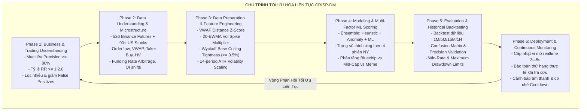

# DeepAlpha — US Stock Machine Learning Scanners & Binance Futures Terminal

Hệ thống giám sát vi mô thị trường thời gian thực, phát hiện bất thường dòng tiền thể chế và phân tích điểm số Machine Learning đa tầng cho **90+ hợp đồng tương lai cổ phiếu Mỹ (TradFi USD-M Perpetual Futures)** và **526 cặp hợp đồng Binance Futures (USDT-M)**, được tổ chức dưới dạng kiến trúc Monorepo tiêu chuẩn doanh nghiệp.

---

## 1. Phương Pháp Luận Tối Ưu Hóa Liên Tục Theo Chu Trình CRISP-DM

Dự án áp dụng chặt chẽ khung quy trình chuẩn quốc tế **CRISP-DM (Cross-Industry Standard Process for Data Mining)** với vòng lặp 6 giai đoạn liên tục nhằm đảm bảo độ chính xác của cảnh báo tín hiệu, triệt tiêu tín hiệu giả (false positives) và tối ưu hóa hệ thống giao dịch vi mô:



### Chi Tiết 6 Giai Đoạn CRISP-DM:

1. **Phase 1 — Business & Trading Understanding (Thấu Hiểu Bài Toán Đầu Tư)**:
   - Xác định mục tiêu định lượng: Đạt độ chuẩn xác $Precision \ge 80\%$ đối với các điểm bùng nổ Breakout và gom hàng thể chế (Accumulation).
   - Tỷ lệ Lợi nhuận / Rủi ro ($Risk:Reward$) tối thiểu $1:2.0$, chốt lời phân tầng $TP_1 (+2.5\%)$, $TP_2 (+5.0\%)$, $TP_3 (+10.0\%)$ với cắt lỗ động $1.5\times ATR$.
   - Giảm thiểu tối đa tín hiệu giả khi thị trường thanh khoản mỏng hoặc cuối tuần.

2. **Phase 2 — Data Understanding & Microstructure (Khai Phá Dữ Liệu Vi Mô)**:
   - Thu thập và phân tích dữ liệu đa khung thời gian: Nến $1M, 5M, 15M, 1H, 1D$, sổ lệnh (Orderbook Depth), tỷ lệ mua chủ động (Taker Buy Ratio), lãi suất vay qua đêm (Funding Rate) và vị thế mở (Open Interest).
   - Phân tích tương quan phiên giao dịch New York: Phiên chính Wall Street ($09:30 - 16:00$ EST), Pre-Market ($04:00 - 09:30$ EST), After-Hours ($16:00 - 20:00$ EST) và Overnight 24/7 Futures.

3. **Phase 3 — Data Preparation & Feature Engineering (Xử Lý Dữ Liệu & Đặc Trưng Vi Mô)**:
   - **Đường Thể Chế VWAP**: $VWAP_{dist} = \frac{Price - VWAP}{VWAP} \times 100\%$.
   - **Hệ số bùng nổ khối lượng (Vol Spike)**: Tỷ lệ thể tích so với đường trung bình $20\text{-}EWMA$.
   - **Độ nén Wyckoff (Range Coiling)**: Biên độ dao động nến $1H \le 3.5\%$ trong 24 giờ.
   - **Biến động thực tế (Realized Historical Volatility - HV)** tính trên chuỗi log-returns.

4. **Phase 4 — Modeling & ML Scoring Calibration (Mô Hình Hóa & Hiệu Chuẩn ML)**:
   - Động cơ Ensemble kết hợp 3 lớp phân loại:
     - Lớp 1: Bộ lọc cấu trúc Wyckoff & vị thế VWAP.
     - Lớp 2: Bộ phát hiện dị biệt thống kê Z-Score thể tích và biến động.
     - Lớp 3: Động cơ chấm điểm tổng hợp ML Score ($0 - 100$) có trọng số hiệu chỉnh theo phiên.

5. **Phase 5 — Evaluation & Historical Backtesting (Đánh Giá & Kiểm Thử Ngược)**:
   - Mô phỏng thực nghiệm trên nến lịch sử $1M/5M$, đo lường Win Rate, Profit Factor, Max Drawdown và thời gian giữ lệnh trung bình.
   - Kiểm thử tự động với 10/10 bài test đơn vị (`tests/test_tradfi_ml_engine.py`, `tests/test_core_engine.py`, `tests/test_risk_management.py`).

6. **Phase 6 — Deployment, Real-time UX & Continuous Monitoring (Triển Khai & Giám Sát)**:
   - Triển khai máy chủ Flask Real-time đa tiến trình, cập nhật vi mô $3.5s$ tự động.
   - **Nguyên tắc xếp hạng thực tế**: Bảo toàn vị trí toàn cục gốc (`globalRank`) khi người dùng lọc ngành hoặc tìm kiếm mã đơn lẻ.

---

## 2. Kiến Trúc Xử Lý Dữ Liệu Vi Mô & Machine Learning Engine

```mermaid
flowchart LR
    subgraph DATA_INGESTION["Thu Thập Dữ Liệu Vi Mô"]
        D1["Binance USDT-M Futures (526 Cặp)"]
        D2["TradFi US Stock USD-M (90+ Cổ Phiếu)"]
        D3["Sổ Lệnh & Dòng Tiền Taker Buy/Sell"]
    end

    subgraph FEATURE_ENGINEERING["Trích Xuất Đặc Trưng (Features)"]
        F1["Đường Thể Chế VWAP & Độ Lệch %"]
        F2["Volume Spike Ratio vs 20-EWMA"]
        F3["Độ Nén Biên Độ Wyckoff 1H <= 3.5%"]
        F4["Funding Rate Âm Sâu & Taker Buy %"]
    end

    subgraph ML_DECISION["Động Cơ ML & Phân Loại"]
        M1["Anomaly Z-Score Detector"]
        M2["Wyckoff Stage Classifier"]
        M3["Multi-Factor ML Score (0-100)"]
    end

    subgraph EXECUTION_UI["Giao Diện & Thực Thi Chiến Lược"]
        U1["Bảng Xếp Hạng & Tra Cứu Toàn Cục"]
        U2["Biểu Đồ Nến TradingView Offline"]
        U3["Chiến Lược Cascade TP/SL + 1.5x ATR"]
    end

    DATA_INGESTION --> FEATURE_ENGINEERING
    FEATURE_ENGINEERING --> ML_DECISION
    ML_DECISION --> EXECUTION_UI
```



---

## 3. Cấu Trúc Mã Nguồn Monorepo

```
crypto-pump-scanner/ (Monorepo Root)
|-- apps/
|   |-- web_terminal/            # Web Terminal UI & REST API Endpoints
|   |   |-- app.py               # Flask Server & Route Controllers
|   |   |-- templates/           # Giao diện Jinja2 HTML (index, top, pre_pump, stocks)
|   |   `-- static/              # CSS Style System, JS Engine & TradingView Offline
|   |
|   |-- cli_scanner/             # Autonomous Command Line Scanner
|   |   `-- main.py              # CLI worker
|   |
|   `-- backtest_runner/         # Vectorized Historical Backtester
|       `-- run_backtest.py      # Backtest script
|
|-- packages/                    # Domain Packages Dùng Chung
|   |-- core_engine/             # Động Cơ ML & Phân Loại Thị Trường
|   |   |-- tradfi_ml_detector.py   # ML Scorer & Trade Plan cho Cổ Phiếu Mỹ
|   |   |-- tradfi_classifier.py    # 8 Phân Ngành & 4 Phiên Giao Dịch New York
|   |   |-- pre_pump_detector.py    # 4 Trụ Cột Phát Hiện Sớm Squeeze Radar
|   |   |-- detector.py             # Anomaly Microstructure Detector
|   |   |-- scoring.py              # Pump Potential Score (0-100)
|   |   `-- classifier.py           # Phân Tầng Bluechip / Mid-Cap / Meme
|   |
|   |-- exchange_connectors/     # Cổng Kết Nối Sàn Giao Dịch
|   |   |-- binance_client.py       # Binance Futures Client
|   |   `-- bybit_client.py         # Bybit Perpetual Client
|   |
|   `-- risk_management/         # Quản Trị Rủi Ro & Kế Hoạch Vào Lệnh
|       |-- cascade_tp.py           # Phân tầng Chốt Lời TP1/TP2/TP3 & Trailing Stop
|       |-- circuit_breaker.py      # Giới hạn lỗ ngày & Thời gian Cooldown
|       `-- backtest_engine.py      # Mô phỏng lịch sử
|
|-- tests/                       # Automated Test Suite (10/10 PASS)
|   |-- test_tradfi_ml_engine.py
|   |-- test_pre_pump.py
|   |-- test_core_engine.py
|   `-- test_risk_management.py
|
|-- pyproject.toml               # Cấu hình dự án
|-- requirements.txt             # Danh sách thư viện phụ thuộc
`-- README.md                    # Tài liệu tổng thể dự án
```

---

## 4. Cài Đặt & Khởi Chạy Hệ Thống

### 1. Cài Đặt Môi Trường
```bash
git clone https://github.com/sinhnguyen1411/us-stock-machine-learning-scanners.git
cd crypto-pump-scanner
pip install -r requirements.txt
```

### 2. Khởi Chạy Web Terminal
```bash
python web_app.py
```
Truy cập giao diện tại:
```
http://localhost:5050/stocks       # TradFi US Stock ML Scanners (90+ mã)
http://localhost:5050/pre-pump      # Pre-Pump Squeeze Radar (10x - 40x)
http://localhost:5050/top           # Top 10 Pump Ranking
http://localhost:5050/              # Realtime Crypto Futures Terminal
```

### 3. Chạy Toàn Bộ Unit Tests
```bash
python -m unittest discover -s tests
```

---

## 5. Bản Quyền & Điều Khoản Sử Dụng

Copyright &copy; 2026 Sinh Nguyen. All rights reserved. **PROPRIETARY AND CONFIDENTIAL**.
Tất cả mã nguồn, kiến trúc thuật toán và giao diện là tài sản sở hữu trí tuệ độc quyền. Nghiêm cấm sao chép, phân phối hoặc sử dụng thương mại khi chưa có văn bản chấp thuận.

